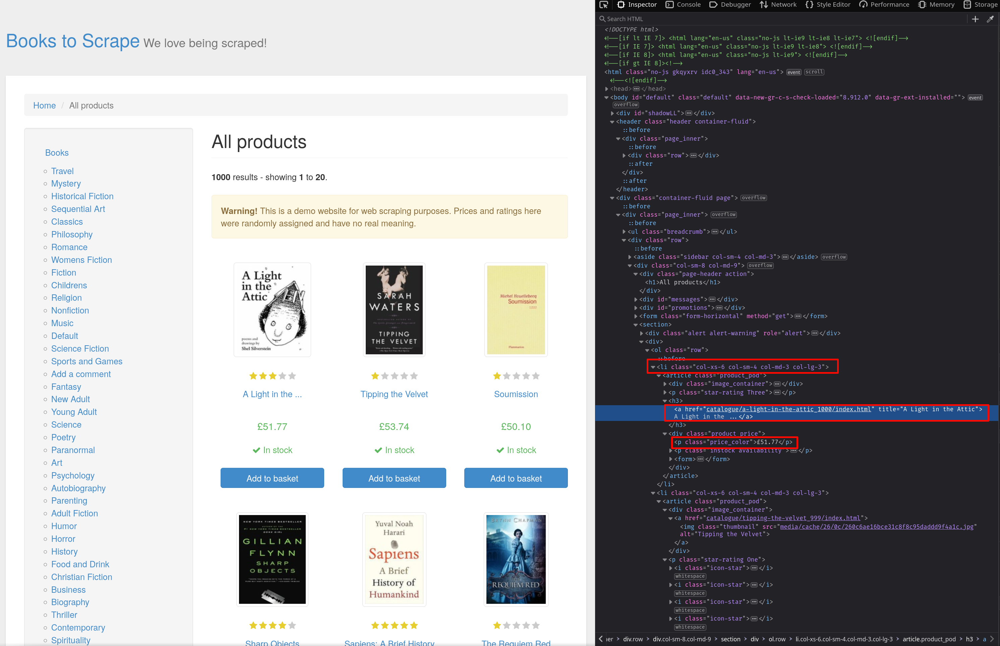
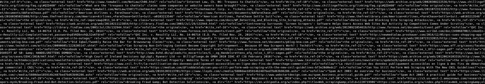

# 使用正则表达式进行网页爬虫

[](https://www.bright.cn/)

本指南介绍如何在[使用 Python 进行网页爬虫](https://www.bright.cn/blog/how-tos/web-scraping-with-python)时运用正则表达式：

- [什么是正则表达式](#什么是正则表达式)
- [在 Python 网页爬虫中使用正则表达式](#在-python-网页爬虫中使用正则表达式)
- [正则表达式用于网页爬虫的局限性](#正则表达式用于网页爬虫的局限性)

## 什么是正则表达式

正则表达式（regex）是用于从文本中提取信息的强大模式匹配公式，因此是网页爬虫中非常实用的工具。这些表达式定义了要在文本中匹配的特定模式，从而实现精准的信息提取。

在 Python 中，正则表达式使用标记来匹配特定模式。本文无法涵盖所有标记，以下是你经常会遇到的一些标记：

| 标记 | 匹配内容 |
| --- | --- |
| 任何非特殊字符 | 给定字符 |
| `^` | 字符串开头 |
| `$` | 字符串结尾 |
| `.` | 除 `\n` 之外的任何字符 |
| `*` | 前一个元素出现零次或多次 |
| `?` | 前一个元素出现零次或一次 |
| `+` | 前面的字符出现一次或多次 |
| `{Digit}` | 前一个元素出现指定次数 |
| `\d` | 任何数字 |
| `\s` | 任何空白字符 |
| `\w` | 任何单词字符 |
| `\D` | `\d` 的反向匹配 |
| `\S` | `\s` 的反向匹配 |
| `\W` | `\w` 的反向匹配 |

如需实际体验并进一步了解正则表达式，请访问 [regexr.com](https://regexr.com/)。此外，[这篇文章](https://docs.bmc.com/docs/discovery/113/improving-the-performance-of-regular-expressions-788111995.html)还提供了优化正则表达式性能的重要技巧。

## 在 Python 网页爬虫中使用正则表达式

本节将使用 Python 和正则表达式开发一个基础网页抓取工具，从多个网站提取数据。

首先，创建项目目录：

```sh
mkdir web_scraping_with_regex
cd web_scraping_with_regex
```

然后创建 Python 虚拟环境：

```sh
python -m venv venv
```

激活该环境：

```sh
source ./venv/bin/activate
```

在 Windows 上则运行：

```
venv\Scripts\activate
```

这个网页爬虫需要两个库：

- 用于获取网页的 `requests`
- 用于解析 HTML 内容并定位元素的 `beautifulsoup4`

安装这些库：

```sh
pip install beautifulsoup4 requests
```

> **注意：** 抓取网站之前，请务必查看其条款和条件，确认网站允许抓取。如果明确禁止，请勿进行爬取。

### 抓取电子商务网站

下面构建一个爬虫工具，从一个[模拟电子商务网站](https://books.toscrape.com/)提取书名和价格。你将抓取第一页，并提取其中图书的名称和价格。

创建名为 `scraper.py` 的文件并导入所需模块：

```python
import requests
from bs4 import BeautifulSoup
import re
```

> **注意：** `re` 模块是 Python 的内置模块，用于处理正则表达式。

接下来，发出 GET 请求以获取网页的 HTML 内容：


```python
page = requests.get('https://books.toscrape.com/')
```

将这些数据传给 Beautiful Soup，以解析 HTML 结构：

```python
soup = BeautifulSoup(page.content, 'html.parser')
```

要了解元素在 HTML 中的结构，可以使用 **检查元素** 工具。在浏览器中打开[网页](https://books.toscrape.com/)，然后按 **Ctrl + Shift + I** 打开**检查器**。如截图所示，产品存储在 class 为 `col-xs-6 col-sm-4 col-md-3 col-lg-3` 的 `li` 元素中。通过读取 `a` 元素的 `title` 属性可以找到书名，而价格存储在 class 为 `price_color` 的 `p` 元素中：



使用 Beautiful Soup 的 `find_all` 方法查找所有 class 为 `col-xs-6 col-sm-4 col-md-3 col-lg-3` 的 `li` 元素：

```python
books = soup.find_all("li", class_="col-xs-6 col-sm-4 col-md-3 col-lg-3")
content = str(books)
```

`content` 变量现在保存了 `li` 元素的 HTML 文本，你可以使用正则表达式提取书名和价格。

首先，再次检查 HTML 结构，创建匹配书名和价格的正则表达式模式。

书名位于 `a` 元素的 `title` 属性中，其形式如下：

```html
<a href="..." title="...">
```

要捕获 title 后双引号内的内容，请使用 `.*?` 正则表达式模式。其中，`.` 匹配任何字符，`*` 匹配前一个元素出现零次或多次，`?` 则使匹配成为非贪婪模式。完整表达式如下：

```regex
<a href=".*?" title="(.*?)"
```

`.*?` 两侧的括号创建了一个[捕获组](https://developer.mozilla.org/en-US/docs/Web/JavaScript/Reference/Regular_expressions/Capturing_group)，用于保存匹配到的内容，以供后续使用。

对于价格，可以使用类似方法。由于价格位于 class 为 `price_color` 的 `p` 元素中，因此正则表达式模式为 `<p class="price_color">(.*?)</p>`。

定义这两种模式：

```python
re_book_title = r'<a href=".*?" title="(.*?)"'
re_prices = r'<p class="price_color">(.*?)</p>'
```

> **注意：** 如果你想知道为什么 `.*` 后需要 `?`，[这个 Stack Overflow 回答](https://stackoverflow.com/a/2301298)很好地解释了 `?` 的作用。

现在，使用 `re.findall()` 从 HTML 字符串中查找所有正则表达式匹配项：

```python
titles = re.findall(re_book_title, content)
prices = re.findall(re_prices, content)
```

最后，遍历匹配项并输出结果：

```python
for i in zip(titles, prices):
    print(f"{i[0]}: {i[1]}")
```

使用 `python scraper.py` 运行此代码。预期输出如下：

```
A Light in the Attic: £51.77
Tipping the Velvet: £53.74
Soumission: £50.10
Sharp Objects: £47.82
Sapiens: A Brief History of Humankind: £54.23
The Requiem Red: £22.65
The Dirty Little Secrets of Getting Your Dream Job: £33.34
The Coming Woman: A Novel Based on the Life of the Infamous Feminist, Victoria Woodhull: £17.93
The Boys in the Boat: Nine Americans and Their Epic Quest for Gold at the 1936 Berlin Olympics: £22.60
The Black Maria: £52.15
Starving Hearts (Triangular Trade Trilogy, #1): £13.99
Shakespeare's Sonnets: £20.66
Set Me Free: £17.46
Scott Pilgrim's Precious Little Life (Scott Pilgrim #1): £52.29
Rip it Up and Start Again: £35.02
Our Band Could Be Your Life: Scenes from the American Indie Underground, 1981-1991: £57.25
Olio: £23.88
Mesaerion: The Best Science Fiction Stories 1800-1849: £37.59
Libertarianism for Beginners: £51.33
It's Only the Himalayas: £45.17
```

### 抓取 Wikipedia 页面

现在，我们来构建一个可抓取 [Wikipedia 页面](https://en.wikipedia.org/wiki/Web_scraping)并提取所有链接相关信息的爬虫工具。

创建名为 `wiki_scraper.py` 的新文件。与之前类似，导入所需的库，发出 GET 请求并解析内容：

```python
import requests
from bs4 import BeautifulSoup
import re

page = requests.get('https://en.wikipedia.org/wiki/Web_scraping')
soup = BeautifulSoup(page.content, 'html.parser')
```

使用 `find_all()` 方法查找所有链接：

```python
links = soup.find_all("a")
content = str(links)
```

由于链接文本位于 `title` 属性中，而 URL 位于 `href` 属性中，因此可以使用 `(.*?)` 模式同时捕获两者。完整表达式如下：

```regex
<a href="(.*?)" title="(.*?)">.*?</a>
```

请注意，第三个 `.*?` 不在捕获组中，因为你并不需要 `a` 标签的内容。

与之前一样，使用 `findall()` 查找所有匹配项并输出结果：

```python
re_links = r'<a href="(.*?)" title="(.*?)">.*?</a>'

links = re.findall(re_links, content)

for i in links:
    print(f"{i[0]} => {i[1]}")
```

使用 `python wiki_scraper.py` 运行此代码时，将得到以下输出：

```
OUTPUT TRUNCATED FOR BREVITY

/wiki/Category:Web_scraping => Category:Web scraping
/wiki/Category:CS1_maint:_multiple_names:_authors_list => Category:CS1 maint: multiple names: authors list
/wiki/Category:CS1_Danish-language_sources_(da) => Category:CS1 Danish-language sources (da)
/wiki/Category:CS1_French-language_sources_(fr) => Category:CS1 French-language sources (fr)
/wiki/Category:Articles_with_short_description => Category:Articles with short description
/wiki/Category:Short_description_matches_Wikidata => Category:Short description matches Wikidata
/wiki/Category:Articles_needing_additional_references_from_April_2023 => Category:Articles needing additional references from April 2023
/wiki/Category:All_articles_needing_additional_references => Category:All articles needing additional references
/wiki/Category:Articles_with_limited_geographic_scope_from_October_2015 => Category:Articles with limited geographic scope from October 2015
/wiki/Category:United_States-centric => Category:United States-centric
/wiki/Category:All_articles_with_unsourced_statements => Category:All articles with unsourced statements
/wiki/Category:Articles_with_unsourced_statements_from_April_2023 => Category:Articles with unsourced statements from April 2023
```

### 抓取动态网站

前面的示例涉及静态网页。抓取动态页面需要使用 [Selenium](https://www.selenium.dev/) 等浏览器自动化工具。以下示例使用 Selenium 和正则表达式从 [OpenWeatherMap](https://openweathermap.org/) 提取当前温度：

```python
from selenium import webdriver
from selenium.webdriver.common.keys import Keys
from selenium.webdriver.common.by import By
from selenium.webdriver.support.wait import WebDriverWait
from selenium.webdriver.support import expected_conditions as EC
import re

driver = webdriver.Firefox()
driver.get("https://openweathermap.org/city/2643743")
elem = WebDriverWait(driver, 10).until( EC.presence_of_element_located((By.CSS_SELECTOR, ".current-temp")))
content = elem.get_attribute('innerHTML')
re_temp = r'<span .*?>(.*?)</span>'
temp = re.findall(re_temp, content)
print(repr(temp))
driver.close()
```

此代码使用 Selenium 启动 Firefox 实例，并通过 CSS 选择器选中包含当前温度的元素。然后，它使用正则表达式 `<span .*?>(.*?)</span>` 提取温度。

此代码通过 Selenium 启动 Firefox，使用 CSS 选择器选中包含当前温度的元素，然后使用正则表达式模式 `<span .*?>(.*?)</span>` 提取温度。

如需更多信息以帮助你开始使用 Selenium 抓取动态网页，请查看[本教程](https://www.bright.cn/blog/how-tos/using-selenium-for-web-scraping)。

## 正则表达式用于网页爬虫的局限性

虽然正则表达式在模式匹配和数据提取方面功能强大，但用于网页爬虫时存在明显局限。正则表达式仅处理文本，并不了解 HTML 结构，因此结果高度依赖 HTML 的格式。

例如，在 Wikipedia 示例中，有些链接未能被正确提取：



如果你编辑 Python 代码并添加 `print(content)` 来输出 Beautiful Soup 返回的 HTML 字符串，就会发现导致问题的 `a` 如下所示：

```regex
<a href="#cite_ref-9">^</a>
```

该标签缺少 `title` 属性，但我们的正则表达式模式假定其结构为 `<a href="(.*?)" title="(.*?)">.*?</a>`。由于正则表达式无法理解 HTML 元素，`.*?` 模式不会直接匹配失败，而是继续匹配字符，直到找到可以完成该模式的内容，这通常会导致错误捕获多个标签。

此外，HTML 并非正则语言，这意味着仅靠正则表达式无法可靠地解析任意 HTML。不过，正则表达式在特定场景中仍然很有用。如果处理的是有限且已知的 HTML 结构，正则表达式可以有效提取信息。但更稳健的方法是使用 Beautiful Soup 等 HTML 解析器查找元素，然后应用正则表达式处理提取出的文本。

下面是改进后的 Wikipedia 爬虫，它使用 Beautiful Soup 进行初步提取，并使用正则表达式进行筛选：

```python
import requests
from bs4 import BeautifulSoup
import re

page = requests.get('https://en.wikipedia.org/wiki/Web_scraping')
soup = BeautifulSoup(page.content, 'html.parser')
links = soup.find_all("a")

for link in links:
    href = link.get('href')
    title = link.get('title')

    if title == None:
        title = link.string

    if title == None:
        continue

    pattern = r"[a-zA-Z0-9]"

    if re.match(pattern, title):
        print(f"{href} => {title}")
```

## 总结

正则表达式是查找文本数据模式的实用工具。然而，网页爬虫还面临许多超出正则表达式处理能力的挑战。频繁抓取可能导致 IP 被封，而验证码也可能会中断爬虫工具的运行。Bright Data 提供[强大的代理](https://www.bright.cn/proxy-types)，可帮助你突破 IP 限制。

今天就开始免费试用！
